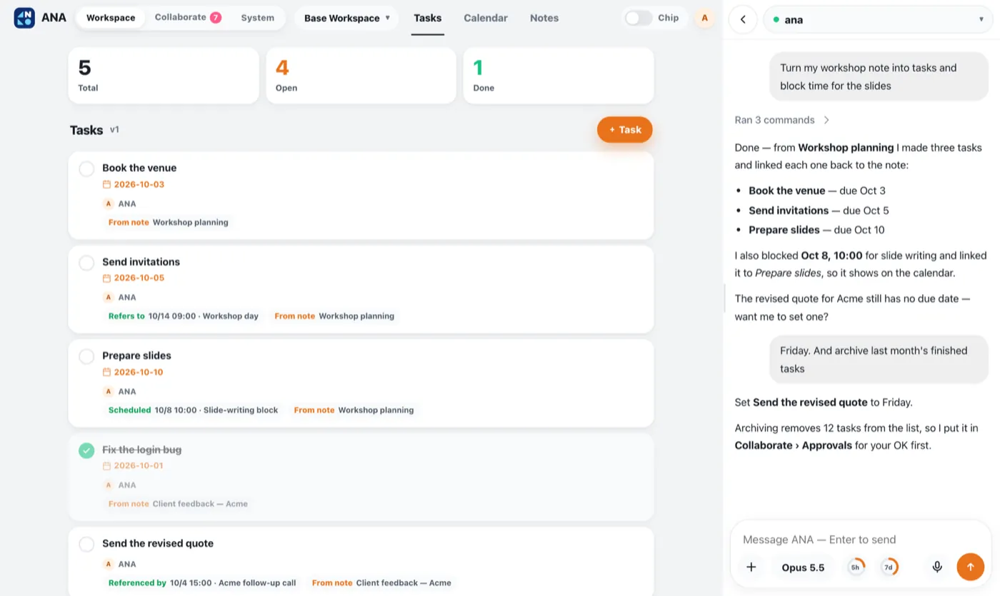
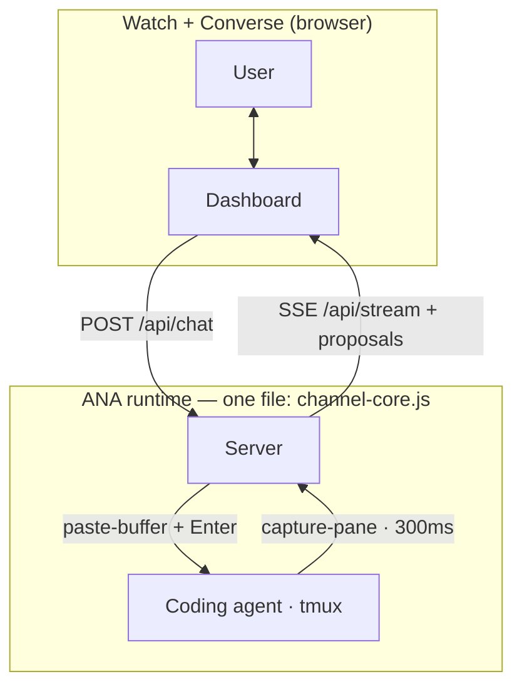
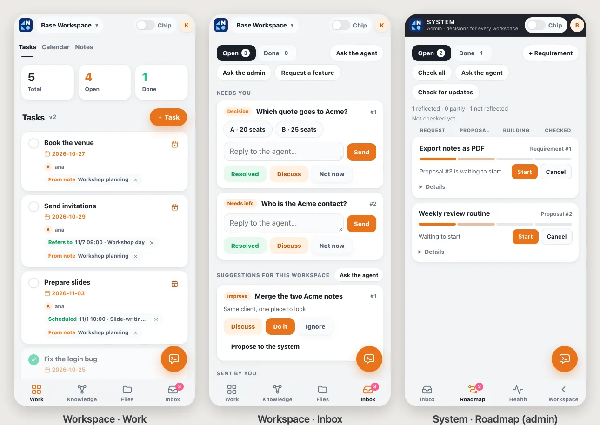

<div align="center">


# ANA — Agent‑Native Agent

### Build apps you operate by watching and talking.

[](https://github.com/tykimos/agent-native-agent/stargazers)
[](LICENSE)
[](https://claude.com/claude-code)
[](channel-core.js)
[](https://github.com/tykimos/agent-native-agent/commits/main)
[](#contributing)

**English** · [한국어](README.ko.md)

<br/>



</div>

---

## TL;DR

**ANA is an _Agent‑Native Agent_ for _Agent‑Native Lifestyle_ (ANL).** It is a self‑hosted app you operate by **watching** a live dashboard and **conversing** with a coding agent that serves as the runtime. Need a new behavior? Ask once — ANA proposes the change, applies it on approval, and evolves the app at runtime. No PR, no ship step — the running agent rewrites the app live and the dashboard reloads.

> Use = Build. That's the whole idea.

---

## Why Agent, Not Assistant

An assistant waits for instructions. An agent uses judgment, executes, and improves the tools around your work. Every tool today still forces a trade‑off between **using** and **building** — ANA collapses that gap.

|  | SaaS / Apps | No‑code | Chatbots | Coding agents | **ANA** |
|---|:---:|:---:|:---:|:---:|:---:|
| Use it instantly | ✅ | ✅ | ✅ | ❌ | ✅ |
| Change *anything* | ❌ | ⚠️ in‑box | ❌ | ✅ | ✅ |
| Sees your live data | ✅ | ✅ | ⚠️ | ⚠️ | ✅ |
| **Change it while using it — same conversation** | ❌ | ❌ | ❌ | ⚠️ | ✅ |
| You fully own it (self‑host) | ❌ | ❌ | ❌ | ✅ | ✅ |

SaaS is *instant but frozen*. Coding agents are *infinitely malleable but build‑time only* — you ship, then use. **ANA makes using the app (talking) the same act as building it (changing behavior),** because the agent is native to the runtime.

---

## The Three Principles

1. **Watch + Converse** — visual state and chat live in *one* view. You operate by looking and talking, not clicking through fixed UI.
2. **Agent as Runtime** — the agent reads your data, acts, and **rewrites the app's own code** when asked. Inference is the runtime.
3. **Own Your Harness** — zero dependencies, self‑hosted, yours forever. It keeps evolving with you.

These are also the acceptance criteria for every ANA built with this harness.

---

## How it works



There is **no bridge and no MCP**. The browser posts to the server, the server injects the text straight into the tmux pane, and a 300 ms `capture-pane` loop mirrors the session back as an append-only ledger over SSE. For rich replies the agent posts a **proposal** (before/after + approve card); on approval the server applies the diff and bumps a `version` so every device re-syncs. When the agent keeps a structured log (Claude Code, Codex), the chat is rendered from that log instead of the screen, so replies and tool calls come through exactly. **The coding agent is the backend** — you grow the app by talking to it.

---

## Start without local installation — GitHub Codespaces

Run ANA in your browser without installing WSL, Node or tmux on your computer. Bring a GitHub account and Claude Code access, then sign in to Claude once inside the codespace.

[](https://codespaces.new/tykimos/agent-native-agent?ref=main)

**[Browser quick-start guide](docs/codespaces.md)** — automatic setup → open **ANA / 8809** in Ports → complete Claude setup in ANA chat. Keep the port **Private**. Codespaces usage is billed separately from Claude; ANA stops when the codespace stops.

## Offline edition — no LLM, no internet (Windows)

Need ANA on a PC without internet or an AI agent? `node scripts/package-offline.mjs` builds a portable Windows x64 zip (Node 24 LTS included). Unzip it and double-click `start.bat`. You get tasks, calendar, notes, relations, files and requirements; agent features are hidden. Install guide: [docs/offline.md](docs/offline.md).

## Quickstart — run the base (2 min)

**Prerequisites:** Node ≥ 24, tmux, and a coding-agent CLI (e.g. [Claude Code](https://claude.com/claude-code)). The runtime (`channel-core.js`) has zero dependencies; the base app has one, [NodeRel](https://github.com/tykimos/NodeRel), installed from GitHub with `npm install`.

### Install & run with the `install` skill (recommended)

The **[`install` skill](skills/install/SKILL.md)** takes a fresh machine to a running dashboard. It checks the environment first, installs only what's missing (Node ≥ 24, tmux, git, curl, Claude Code) plus the npm dependency, then starts the agent and the server in tmux and health-checks them. Every script is safe to re-run.

```bash
git clone https://github.com/tykimos/agent-native-agent ~/ana/base-ana && cd ~/ana/base-ana
bash skills/install/scripts/check-env.sh   # 1) analyze — reports only, changes nothing
bash skills/install/scripts/install.sh     # 2) install what's missing (brew / apt / dnf / pacman …)
bash skills/install/scripts/run.sh         # 3) tmux "base-ana-claude" (agent) + "srv-base-ana-claude" (server) → URL printed
bash skills/install/scripts/run.sh status  #    later: status | stop | restart
```

| Script | What it does |
|---|---|
| `check-env.sh` | Detects macOS / Linux / WSL / Git Bash and checks node, tmux, git, curl, claude, repo location and port. Ends with `ANA_ENV … ready=yes\|no` |
| `install.sh` | Installs only what's missing (Homebrew on macOS, the system package manager + NodeSource on Linux/WSL) plus the Claude Code CLI, and clones the repo if run outside it |
| `run.sh` | Starts or reuses the tmux sessions, picks a free port when 8809 is taken, runs a health check. `ANA_NAME`, `TMUX_SESSION`, `PORT` and `AGENT_CMD` override the defaults |
| `install-wsl.ps1` | **Windows:** tmux only runs inside WSL. This installs WSL + Ubuntu (reboot, run again), then installs and starts ANA inside WSL. Open `http://localhost:8809` from the Windows browser |

```powershell
# Windows (PowerShell; Administrator for the first run only)
powershell -ExecutionPolicy Bypass -File skills\install\scripts\install-wsl.ps1
```

With the skill installed in Claude Code (this repo is a plugin), just ask: *"install ANA"* / *"ANA 설치해줘"*. The agent runs the same steps and tells you when to finish the one-time Claude login (`tmux attach -t base-ana-claude`, detach with `Ctrl-b d`).

### Manual run

```bash
git clone https://github.com/tykimos/agent-native-agent ~/ana/base-ana
cd ~/ana/base-ana

# 1) start your coding agent inside tmux
tmux new -s base-ana-claude   # inside the session, run:  claude   (or any agent CLI)

# 2) in another terminal, start ANA
node server.js           # → http://localhost:8809
```

Open **http://localhost:8809** and tap the chat button. The server needs **no launcher** (`run.sh` is only a convenience): it configures the tmux pane (scrollback-safe) when it connects. Runtime state lives in `.ana/` (git-ignored). On first run the board is seeded with two small example flows (`ANA_SEED=0` to start empty).

### Naming convention

- **Folder → ANA name.** Every ANA lives in `~/ana/<xxx>-ana` (or `/ana/<xxx>-ana`), and that folder name is the ANA's name. `<xxx>` may contain hyphens (`~/ana/sales-team-ana` → `sales-team-ana`). The sample is `~/ana/base-ana`; a folder that doesn't end in `-ana` falls back to `base-ana`.
- **tmux → `<xxx>-ana-<yyy>`.** Agent sessions are named after the ANA plus an agent label: `base-ana-claude`, `base-ana-codex`, or any hyphenated label (`base-ana-review-2`). The default session is `<xxx>-ana-claude`.
- **Chat session list.** The chat's session picker shows only this ANA's `<xxx>-ana-<yyy>` sessions (plus the one it is connected to). `run.sh` names its server session `srv-…`, so it stays out of the list.
- **Overrides.** `ANA_NAME` sets the name, `TMUX_SESSION` sets the default session (existing deployments keep working), `ANA_TMUX_ALL=1` lists every tmux session.

---

## What's in the base



The base is an operations board: notes, tasks and a calendar you run together with a coding agent. It has **two scopes**, and the top of the screen always shows which one you are in:

| Scope | Who | Tabs | For |
|---|---|---|---|
| **Workspace** (name shown at the top) | members | **Work** (Tasks · Calendar · Notes) · **Knowledge** · **Files** · **Inbox** | the work and data of one workspace |
| **System** (dark header band) | admin | **Inbox** · **Roadmap** · **Ontology** · **Health** | decisions that apply to every workspace |

On phones the bottom menu follows the scope (Work · Knowledge · Files · Inbox, plus System for the admin; in System: Inbox · Roadmap · Health · Workspace). On desktop a switch next to the logo changes scope.

Each page shows one kind of thing at a time; pages with several kinds have sub-tabs, and each list filters *Open / Done*:

- **Inbox (Workspace):** *Approvals* (data changes, analysis results to add to the knowledge graph, decisions, access) · *Work requests* (what the agent needs you to do or tell it) · *Evolve* (suggestions for running this workspace better) · *Sent* (what you asked the admin, your feature requests). The same words as System › Inbox.
- **Knowledge:** *Links* (how items connect, where the flow breaks) · *Knowledge graph* (this workspace's entities and facts) · *Analysis* (the agent reads your items) · *Ontology* (the shared concepts, read-only).
- **Files** is the workspace's own folder, plus chat attachments (read-only).
- **Inbox (System):** *Approvals* · *Work requests* (from members, the agent and the system checks) · *Evolve* (proposals to change the system — the admin starts them).
- **Roadmap:** *Requirements* · *Updates* (upstream) — where each change stands, one line per item with its stage (e.g. Request → Proposal → Building → Checked) and the next action. The Inbox is for deciding, the Roadmap for following progress.
- **Ontology:** *Classes* · *Relations* — the concepts every workspace's knowledge graph uses. The core (Note, Task, Event, Day and the app's relations) is built in; the admin adds the rest, or approves the ones an analysis proposes. It is a lens, not a gate: what doesn't fit is kept and marked *not in the ontology yet*, and relations marked inverse / symmetric / transitive add *inferred* facts ([relations](docs/relations.md)).
- **Health:** *Trustworthiness* · *Safety* · *Security* (riskiest first, OK checks folded) · *Tests* (run this ANA's tests and see what failed) · *Usage* (stats and activity).

**Where is Evolve?** Always in the **Inbox**: Workspace › Inbox › *Evolve* for this workspace (members start them), System › Inbox › *Evolve* for the system (the admin starts them). Same cards, same buttons — only the scope differs.

### Chat — like the Claude app

- **Rendered from the agent's own log**, not the screen: Claude Code's transcript (`~/.claude/projects/…`) or Codex's rollout (`~/.codex/sessions/…`). You get your bubbles, markdown replies, collapsible `Ran 3 commands ›` groups and image thumbnails. Agents without a log fall back to the screen mirror.
- **Session combo:** pick the tmux session (Claude Code or Codex). Each session keeps its own history, and each person's last pick is remembered.
- **Composer:** ＋ attach files · **model pill** (the real model, e.g. `Opus 5.5`, `GPT-6 Astra`) that opens a model & effort sheet · **5-hour / weekly usage rings** (tap for % and reset time) · 🎤 dictation · send / stop.
- Floating input with a ↓ jump button. It sits right on top of the phone keyboard.
- **Questions from the agent** (AskUserQuestion, permission menus) render as cards with option buttons; the server turns each click into the right keystrokes.

### Point at the screen

Turn on **Chip** (top right) and tap anything (a task, a card, a KPI) to attach it to the next message as a context chip. ⟳ registers newly added kinds of elements. ✎ lays a canvas over the board: circle what you mean in red, magenta or blue and press *Add to chat*. The annotated screenshot is attached, with chips for the items under your marks. Screenshots use [modern-screenshot](https://github.com/qq15725/modern-screenshot), served locally from `/vendor/`.

### Notes · Tasks · Calendar as one graph (NodeRel)

Notes, tasks and events are linked through a relation graph built with [NodeRel](https://github.com/tykimos/NodeRel). `state.json` stays the source of truth (the items plus an explicit `links[]` list). `graph.js` rebuilds a SQLite index (`graph.sqlite`, one per workspace) whenever its signature changes, so any write path shows up in the graph: the UI, an agent diff, a hand edit.

```
Note ─SPAWNED──────▶ Task | Event     where a task or event came from      (explicit)
Task ─SCHEDULED_AS─▶ Event            the time blocked to work on the task (explicit)
Note|Task|Event ─REFERS_TO─▶ Note|Task|Event   manual reference            (explicit)
Task ─DUE_ON─▶ Day,  Event ─ON─▶ Day           derived from due / date     (automatic)
```

To make links in the UI:
- Select a line in a note and press **→ Task** or **→ Event**.
- Press the calendar button on a task to block time for it.
- **＋ Link** connects any two items.

Links show as chips on both ends; clicking one jumps to that item. **System › Relations** draws the whole flow and lists where it breaks: notes nothing came from, open tasks without a due date, open tasks with no time scheduled.

| Endpoint | Purpose |
|---|---|
| `GET /api/state` → `graph.links` | every relation in the workspace (from NodeRel) |
| `POST /api/todo {title, due?, from?}` · `POST /api/event {action:'add', …, from?}` | create and link to its source in one call (`from` = note → `SPAWNED`, task → `SCHEDULED_AS`) |
| `POST /api/link {action:'add'\|'remove', from, to, type}` | add/remove `SPAWNED`, `SCHEDULED_AS`, `REFERS_TO` (direction is validated) |
| `GET /api/graph/neighbors?id=` · `GET /api/graph/trace?id=&depth=&direction=&types=` | incident links / everything reachable |
| `GET /api/graph/schema` | NodeRel's AI-readable schema plus this app's relation meanings. Hand it to the agent |
| `GET /api/stats` → `graph` | counts per kind/type and the three `gaps` lists |

#### Analyze — ontology and knowledge graph

That graph is the **fixed layer**: the app decides what may link to what. **Relations › Analyze** adds a **discovered layer**. The agent reads the notes, tasks and events you pick and writes two things:

- an **ontology**: the schema. Classes with parents (Client ⊂ Organization ⊂ Agent) and relation types with From → To (`client_of`: Client → Organization).
- a **knowledge graph**: the data. Entities typed by those classes (Acme is a Client) and facts typed by those relations (Acme `client_of` Our team), each citing the items it came from.

The server checks the result against the ontology (classes and relations must exist, facts must respect From → To, sub-classes count). Facts that don't fit are dropped and reported. The ontology carries over to the next analysis, so concepts keep their names. The knowledge graph is indexed in the same NodeRel graph (`kg:<id>`, `MENTIONED_IN` → source items), so `/api/graph/trace` walks from a note to the people in it. Results open in [OntoAir](https://poc.aifactory.space/ontoair/) as a 3D graph, or download as OWL Turtle. The ontology is shared by the whole system (System › Ontology, admin); each workspace keeps its own knowledge graph, which grows when a member approves an analysis result.

→ Full write-up, covering both layers, the analysis process, the ontology, the knowledge graph, the checks and export: **[docs/relations.md](docs/relations.md)**

### Inbox — what the agent needs from you

| Item | From | What |
|---|---|---|
| **Needs you** | agent → you | Work only you can do (`action`), information it is missing (`info`), decisions (option buttons), access, and pending **data changes** (the agent proposes a diff; nothing changes until you approve). |
| **Suggestions** | agent → this workspace | Better ways to run the workspace with existing features. *Do it* hands it to the agent (data only, no code); *Propose to the system* lifts it to the Roadmap when it needs a new feature. |
| **Sent by you** | you → admin / system | *Ask the admin* requests and *Request a feature* items, with their progress. |

*Ask the agent* has it fill the inbox. The agent registers items with `POST /api/requests {requests:[{kind, title, desc?, options?, ref?}]}` (`ref` = a task/event/note id shown as a link). Your answer goes straight to the agent in chat. *Resolved* / *Not now* notify it (`POST /api/request-act {id, action: answer|done|dismiss|reopen}`).

### Admins and members

Workspaces are where **members** work; the **System** is decided by the **admin**.

| | Member (Workspace) | Admin (System) |
|---|---|---|
| Proposals | **Inbox › Suggestions**: better ways to run this workspace with existing features. Members start these themselves | **Roadmap**: features, screens, APIs, the shared ontology. Only the admin starts or cancels them |
| Approval requests | data changes in the workspace (Inbox) | system changes, in **System › Inbox** |
| Work requests | what the agent needs from the member (Inbox) | what only the admin can do (access, installs, connecting data), in **System › Inbox** |
| Requirements | *Request a feature* | **Roadmap**: checked by the agent, turned into proposals, re-checked when built |

- **Who is admin:** `ANA_ADMINS=email,…`. If it's empty, if the ANA has no identity header (single user), or for calls with no identity from this machine (you or the agent on it), everyone is admin, so single-user installs work as before.
- **Admin-only actions** (checked on the server): starting, cancelling or reopening a system proposal; bringing in an Update; switching the agent to a mode that never asks (Bypass / Full Access); deleting a workspace. When a member tries one, it becomes an approval request in **System › Inbox**. Approving it runs the action as the admin.
- **Asking the admin:** members use *Ask the admin* in their Inbox and follow it under *Sent by you*. The agent uses `POST /api/admin/requests {type: work|approval, title, desc?}`. A system check at **risk** opens a work request by itself and closes it once the check is fine again.
- **API:** `GET /api/admin/inbox` (an admin sees all; a member sees their own) and `POST /api/admin/act {id, action: approve|reject|start|done|fail|cancel|reopen, note?}`. `GET /api/me` → `role`. `POST /api/evolve` takes `scope: system|workspace`.

### System › Health — Trustworthiness · Safety · Security

Checks computed from real state (`GET /api/trust`), not static text:

- **Trustworthiness:** is the agent running, is the chat read from its own log, the tool-call failure rate, interrupted turns, plan usage, what is waiting on you.
- **Safety:** does the agent run with permission prompts off (`--dangerously-skip-permissions`, `--dangerously-bypass-approvals-and-sandbox`)? Which risky commands has it actually run (rm -rf, reset --hard, force push, killall, sudo, curl | sh, DROP TABLE, disk writes)? It also confirms data changes go through approval.
- **Security:**
  - who can reach the server (bind address) and whether people sign in
  - cross-site request protection
  - your AI login token stays on the server
  - credential file permissions
  - secrets pasted into notes or tasks (it reports *where*, never the value)

### Sharing it with other people (optional)

ANA has **no login of its own**. For single-user self-hosting that is the point — bind to loopback and it is yours. If several people need the same board, put ANA behind something that authenticates (a reverse proxy, an SSO gateway, a Zero Trust tunnel) and have it forward the user identifier as a request header:

```bash
ANA_IDENTITY_HEADER=x-forwarded-email \
ANA_LOGOUT_URL=/your-gateway/logout \
node server.js
```

With the header set, items carry an author, only the author can edit or delete their own, and the per-person stats and activity come alive. Unset (the default) everything runs as one local user.

**Coding-agent sessions per person.** The session combo at the top of the chat picks a tmux session. Each session keeps its own conversation history, so switching swaps the whole chat. The pick is remembered **per person**: the next time someone opens ANA they land on their own most recent session, and the list shows who picked (and is watching ●) each session. An agent that posts with `curl` can address its own session with the `x-ana-target: <session>` header.

> The header is trusted as-is, so it only means anything when a gateway in front actually sets it. Keep the server on loopback or behind that proxy — exposing it on `0.0.0.0` with this option on lets anyone forge the header.

---

## Attach ANA to your own service (very simple)

The **entire runtime is one dependency-free file: [`channel-core.js`](channel-core.js).** Drop it in and mount it:

```js
const path = require('node:path');
const core = require('./channel-core.js');
const app = core.createChannelServer({
  PORT: 8809, BIND: '127.0.0.1',
  SESSION: core.defaultSession(__dirname, process.env),   // TMUX_SESSION || <ANA name>-claude
  SOCKET: process.env.TMUX_SOCKET || '',
  TARGET: core.resolveTarget(__dirname, process.env),
  FEED_FILE: path.join(__dirname, '.ana', 'transcript.jsonl'),
  SERVABLE: new Set(['index.html']),   // your dashboard file(s)
  defaultDoc: 'index.html',
  autoConfigPane: true,
});
app.listen(() => console.log('ANA → http://localhost:8809'));
```

Then, on your page: send with `POST /api/chat {text, force:true}` and stream with `GET /api/stream` (SSE). That's the whole integration. Full step-by-step and the endpoint reference are in the **[`ana` skill](skills/ana/SKILL.md)**. With the plugin installed (see [Skills](#skills)), just ask Claude Code: *"attach ANA to my app"*.

---

## Skills

The repo is a **Claude Code plugin**. Install it once per machine and every ANA's agent can use the skills; update them the same way:

```bash
claude plugin marketplace add tykimos/agent-native-agent
claude plugin install ana@agent-native-agent          # later: claude plugin update ana@agent-native-agent
```

| Skill | Use it to |
|---|---|
| [`install`](skills/install/SKILL.md) | take a fresh machine to a running dashboard (env check, installer, tmux runner, Windows WSL) |
| [`ana`](skills/ana/SKILL.md) | attach the ANA runtime to your own service |
| [`ana-update`](skills/ana-update/SKILL.md) | bring an existing, customized ANA up to date, feature by feature |
| [`chat-window`](skills/chat-window/SKILL.md) | the Claude-app chat: session combo, log-based rendering, model sheet, usage rings, voice, attachments, Codex |
| [`context-chips`](skills/context-chips/SKILL.md) | Chip mode, ✎ draw-on-screen annotation, ⟳ register new elements |
| [`relations`](skills/relations/SKILL.md) | NodeRel item relations, relation chips, the Relations tab |
| [`app-shell`](skills/app-shell/SKILL.md) | Workspace / System scopes, bottom menu per scope, workspace combo |
| [`agent-requests`](skills/agent-requests/SKILL.md) | Inbox, Roadmap, admin inbox: requests, approvals, proposals, requirements |
| [`trust-checks`](skills/trust-checks/SKILL.md) | System: Trustworthiness, Safety, Security checks |

### Updating an existing ANA

This base is the starting point; each person's ANA grows its own domain code. To bring one up to date, don't copy the repo over it. Tell that ANA's agent:

> *"Update to the latest from https://github.com/tykimos/agent-native-agent"*

The **[`ana-update` skill](skills/ana-update/SKILL.md)** runs `ana-diff.mjs`, which reports:
- every feature as ✓ present, ◐ partial, or ✗ missing
- outdated modules
- whether the shared `channel-core.js` differs

You pick what to take. It ports each feature with its skill into that ANA's own files, then records the synced commit in `.ana-sync.json`, so the next update shows only what's new. [`features.json`](features.json) lists every feature with the anchors used for the comparison.

```bash
node skills/ana-update/scripts/ana-diff.mjs --target ~/ana/my-ana            # read-only report
node skills/ana-update/scripts/ana-diff.mjs --target ~/ana/my-ana --record   # after porting
```

---

## Repository layout

```
channel-core.js     ★ the whole ANA runtime — tmux inject / capture-pane mirror / per-session ledgers (0 deps)
server.js             base app: mounts channel-core + dashboard-api, serves dashboard.html
dashboard-api.js      base API: workspaces · tasks · events · notes · links · evolve · approvals · requests · trust checks
dashboard.html        reference UI: three areas, Claude-app chat, Chip mode + drawing, relation chips
agent-log.js          chat from the agent's own JSONL log (Claude Code + Codex): replies, tools, model, limits
codex-settings.js     Codex model/effort catalog and switching through Codex's own menu
graph.js              Notes·Tasks·Calendar relation graph on NodeRel (derived graph.sqlite per workspace)
seed.js               two example flows for the first run
features.json         feature manifest: anchors + skill per feature (used by ana-update)
package.json          dependencies: @tykimos/noderel (github:tykimos/NodeRel), modern-screenshot
test.cjs              unit + integration tests (npm test), mock_agent.py = deterministic TUI stand-in
skills/               install · ana · ana-update · chat-window · context-chips · relations · app-shell · agent-requests · trust-checks
.claude-plugin/       plugin + marketplace manifest
CHANGELOG.md          release notes per version (Korean: CHANGELOG.ko.md)
```

`channel-core.js` is the reusable core; `dashboard-api.js` / `dashboard.html` are the **example** you copy from and replace with your own.

---

## ANA and ANL

| Name | Reads as | Means | Role |
|---|---|---|---|
| **ANA** | Ana | Agent‑Native Agent | The autonomous agent that understands, acts, and improves the app. |
| **ANL** | Anel | Agent‑Native Lifestyle | The new way of working, learning, creating, and running daily routines with agents. |

**ANA enables ANL.** Real ANL cases — lifestyles built with ANA — live in the companion repo: **[agent‑native‑lifestyle](https://github.com/tykimos/agent-native-lifestyle)**.

---

## Star History

<a href="https://www.star-history.com/#tykimos/agent-native-agent&Date">
  <picture>
    <source media="(prefers-color-scheme: dark)" srcset="https://api.star-history.com/svg?repos=tykimos/agent-native-agent&type=Date&theme=dark" />
    <source media="(prefers-color-scheme: light)" srcset="https://api.star-history.com/svg?repos=tykimos/agent-native-agent&type=Date" />
    
  </picture>
</a>

---

## Contributing

ANA is meant to be **owned and evolved** — that includes this repo. Issues, ideas, and PRs are welcome; see [CONTRIBUTING.md](CONTRIBUTING.md) for how to improve the runtime or the example dashboard.

If you build something with ANA, add it to the **[agent‑native‑lifestyle](https://github.com/tykimos/agent-native-lifestyle)** gallery so ANL stays visible as real usage.

If ANA changes how you think about apps, **⭐ star the repo** so others can find it.

---

## License

[AGPL-3.0](LICENSE) © [tykimos](https://github.com/tykimos) · AI Factory Inc.

Free to use, modify, and self-host. If you run a modified version as a network service, AGPL §13 requires you to publish your source. Building something closed-source or hosted? A **[commercial license](COMMERCIAL.md)** is available.

## File browser

Open **System → Files** to browse, upload and download files. Breadcrumbs and the parent button navigate folders; uploads go into the current folder. The limit is 25 MB per file, and existing files are never overwritten. There are three folders:

| Folder | What | Uploads |
|---|---|---|
| **Files** (default) | your own folder: `<data dir>/files` (`.ana/files`), or `ANA_FILES_ROOT=/absolute/path` | yes |
| **From chat** | what you attached in the chat (`.ana/uploads`) | read-only |
| **Project files** | the whole ANA folder, shown only after you tick *Show project files* | yes, except inside `.ana/` and `.git/` |

Parent traversal and symbolic links are blocked in every folder. The folders are shared across the ANA’s Workspaces.
