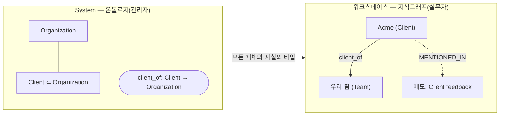
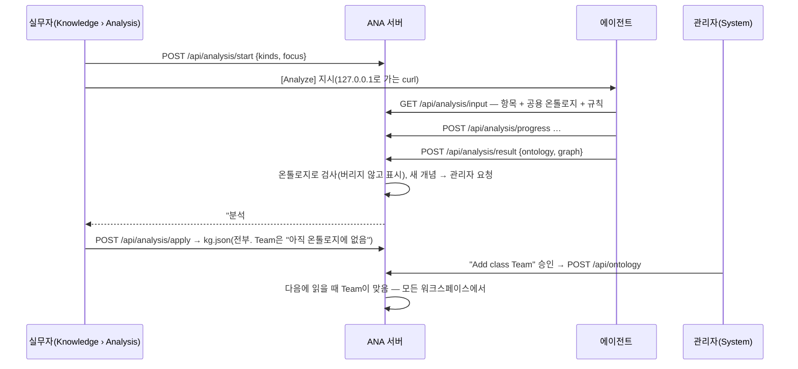

# ANA의 관계 — 온톨로지와 지식그래프

[English](relations.md) · **한국어**

ANA는 **어떤 종류의 것이 있는가(틀)**와 **실제로 무엇을 아는가(사실)**를 나눕니다.

| | 온톨로지(틀, TBox) | 지식그래프(사실, ABox) |
|---|---|---|
| **범위** | **System** — ANA 전체에 하나, 모든 워크스페이스가 공유 | **워크스페이스**마다 — 자기 개체와 사실 |
| **누가 바꾸나** | **관리자**(System › Ontology). 분석이 제안한 새 개념은 System › Inbox에 승인요청으로 옴 | **실무자**가 분석 결과를 승인해서(Inbox › Approvals 또는 Knowledge › Analysis) |
| **담는 것** | 부모가 있는 클래스(Client ⊂ Organization), From → To가 있는 관계 종류 | 클래스로 타입이 정해진 개체, 관계로 이어진 사실. 각각 근거 메모·할일·일정을 가리킴 |
| **저장** | `evolve.json` 옆의 `ontology.json`(+ 앱이 정한 핵심) | 워크스페이스 `state.json` 옆의 `kg.json` |
| **보는 곳** | System › Ontology(편집) · Knowledge › Ontology(읽기 전용) | Knowledge › Knowledge graph |

온톨로지에는 **앱이 정한 핵심**이 있습니다. 클래스 Note, Task, Event, Day와 관계 SPAWNED, SCHEDULED_AS, REFERS_TO, DUE_ON, ON입니다(`graph.js`의 `RULES`/`MEANINGS`). 핵심은 고칠 수 없습니다. 그 밖의 것(Client, works_for 등)은 관리자가 더합니다.

> **온톨로지는 관문이 아니라 렌즈입니다.** 도메인 하네스입니다. 에이전트에게 함께 쓰는 말을 주고, ANA가 검사하고 추론하게 해 줍니다. 에이전트가 찾거나 제안할 수 있는 것을 막지는 않습니다.
> - 틀에 안 맞는 것은 버리거나 붙잡아 두지 않습니다. **남기고 표시합니다**(*아직 온톨로지에 없음*).
> - 관리자에게 그 개념을 더해 달라고 요청하고, 더해지면 바로 맞게 됩니다.
> - 진화 제안은 온톨로지 밖으로 나가도 되고, 온톨로지를 바꾸자고 해도 됩니다.

### 일곱 개념과 그 연결

| 개념 | 무엇인가 | 어디에 |
|---|---|---|
| **온톨로지** | 함께 쓰는 말. 클래스(부모 포함)와 관계 종류(From → To, 선택으로 역관계·대칭·전이) | System — 관리자가 다듬음 |
| **지식그래프** | 실제로 찾은 것과 사실. 각각 근거 항목을 가리킴 | 워크스페이스마다 — 실무자가 분석을 승인해 쌓음 |
| **System** | 모든 워크스페이스에 걸리는 것: 기능, 온톨로지, 헬스 | 관리자 |
| **워크스페이스** | 한 팀의 데이터: 메모·할일·일정·파일·지식그래프 | 실무자 |
| **NodeRel** | 앱 링크와 지식그래프를 한 색인(`graph.sqlite`)에. 에이전트가 메모 → 개체 → 개체로 따라감 | 둘 다 |
| **온톨로지 추론** | 지식그래프에 대한 정해진 규칙. 맞는지(domain → range, 하위 클래스), 상위 클래스, 역관계, 대칭, 전이. 읽을 때 계산하고 `inferred`로 표시하며 저장하지 않음 | 서버(`kgLens`) |
| **LLM 추론** | 에이전트가 항목을 읽고 개체·사실·새 개념을 제안([Analyze])하거나 시스템을 바꾸자고 제안([Evolve]). 자유롭고, 온톨로지는 안내만 함 | 에이전트 |

LLM 추론은 지식을 **더하고** 새 말을 제안합니다. 온톨로지 추론은 그것을 **검사하고**, 말이 이미 뜻하는 것으로 **넓힙니다**. 어느 쪽도 다른 쪽을 막지 않습니다.



---

## 지식이 쌓이는 과정



1. **분석.** 실무자가 메모·할일·일정과 (선택) 초점을 고릅니다. 에이전트는 **공용 온톨로지**와 함께 항목을 읽고(`GET /api/analysis/input` → `ontology` + `rules`), 진행률을 보고합니다.
2. **결과.** `POST /api/analysis/result {summary, ontology:{classes, relations}, graph:{entities, facts}}`. 서버가 온톨로지로 검사하고(아래), 개수와 `issues`, `newConcepts`를 돌려줍니다.
3. **새 개념은 관리자에게, 정리 요청으로.** 온톨로지에 없는 클래스나 관계는 System › Inbox의 요청이 됩니다("Add class "Team" to the ontology", `action: ontology.add`). 결과에 선언한 것이든 그냥 쓴 것이든 같습니다. 아무것도 막지 않습니다. 그 개념은 이미 쓰이고 있습니다.
4. **지식그래프에 더하기는 실무자가.** 결과는 저절로 들어가지 않습니다.
   - **Inbox › Approvals**와 Knowledge › Analysis에 뜹니다.
   - *Add*를 누르면 `kg.json`에 합칩니다. 개체는 id로 합치고(근거도 합침), 사실은 from·rel·to로 합칩니다.
   - 전부 들어갑니다. 기다리는 것은 없습니다.
5. **맞는지는 저장하지 않고 읽습니다.** `GET /api/kg`는 개체와 사실마다 `fit`과 `why`를, 그리고 `notFitting` 개수를 돌려줍니다. 그림에서는 주황으로 보입니다. 관리자가 개념을 더하면 다음에 읽을 때 맞음이 됩니다. (예전 버전이 붙잡아 둔 사실은 아무 개념이나 승인될 때 들어갑니다.)
6. **버리기와 지우기.** *Discard*는 그 결과만 버리고, 이미 더한 지식은 남깁니다. 틀린 개체나 사실은 실무자가 지울 수 있습니다(`POST /api/kg {action: remove-entity|remove-fact}`).

## 결과를 온톨로지로 검사하기

`cleanAnalysis(body, itemIds, systemOntology())`. 아는 개념은 공용 온톨로지에 결과가 제안한 개념을 더한 것입니다.

| 검사 | 어기면 |
|---|---|
| 크기(클래스 80, 관계 80, 개체 400, 사실 1200) | 나머지는 잘림 |
| `class.parent`, `relation.domain/range`가 있는가 | 비우고 issue |
| `entity.class`가 있는가 | 남김, issue, 개념은 관리자에게 |
| `fact.from/to`가 개체인가 | 사실 버림, issue(버리는 것은 이것뿐) |
| `fact.rel`이 있는가 | 남김, issue, 개념은 관리자에게 |
| `from`의 클래스가 domain **또는 그 하위 클래스**인가, `to`와 range도 같은 방식 | 남김, 안 맞음 표시, issue |
| 근거가 이 작업의 항목인가 | 해당 id 제거 |

지식그래프를 읽을 때 domain → range를 **지금의** 온톨로지로 한 번 더 확인합니다.

## 온톨로지 추론

`kgLens(kg, ontology)`는 지식그래프를 읽을 때마다 돕니다(`GET /api/kg`, NodeRel). 끌어낸 것은 저장하지 않습니다.

| 규칙 | 관계에 표시 | 이것에서 | 끌어냄 |
|---|---|---|---|
| 하위 클래스 | 클래스의 *Kind of* | pat은 Person, Person ⊂ Agent | `types: [Person, Agent]` |
| 역관계 | *Inverse*(어느 한쪽) | pat works_for acme, employs ⇄ works_for | acme employs pat |
| 대칭 | *Symmetric* | o1 partners acme | acme partners o1 |
| 전이 | *Transitive* | o1 part_of o2, o2 part_of o3 | o1 part_of o3 |

끌어낸 사실은 `inferred` 목록에 `inferred: true`, `rule`, `because`(근거가 된 사실)와 함께 옵니다.
- 그림에서는 점선입니다(*Inferred* 토글). 개체 패널에 표시가 붙습니다.
- NodeRel 선에는 `inferred`와 `rule`이 붙습니다.
- Turtle 내보내기는 `owl:inverseOf`, `owl:SymmetricProperty`, `owl:TransitiveProperty`를 씁니다. 그래서 OntoAir 같은 다른 추론기도 같은 것을 할 수 있습니다.

## NodeRel 안의 지식그래프

워크스페이스마다 `kg.json`이 앱 링크와 같은 `graph.sqlite`에 들어갑니다.
- 개체는 `kg:<id>`이고, kind는 클래스입니다.
- 사실은 관계 id를 타입으로 갖습니다.
- 개체와 근거 항목은 `MENTIONED_IN`으로 이어집니다.

그래서 에이전트가 메모에서 그 안의 사람까지 따라갈 수 있습니다.

```bash
curl -s "http://127.0.0.1:8811/api/graph/trace?id=n-ex-acme&depth=2"
curl -s "http://127.0.0.1:8811/api/graph/neighbors?id=kg:acme"
curl -s "http://127.0.0.1:8811/api/graph/schema"     # 기본 어휘 + 온톨로지의 관계
```

Links 그림과 "흐름이 끊긴 곳"은 기본 관계만 씁니다.

## 내보내기와 OntoAir

- **지식그래프:** `GET /api/kg/ttl`이 OWL Turtle을 씁니다.
  - 공용 온톨로지는 TBox입니다: `owl:Class` + `rdfs:subClassOf`, `owl:ObjectProperty` + `rdfs:domain/range`.
  - 워크스페이스 지식그래프는 ABox입니다.
  - Knowledge › Knowledge graph에 *Open in OntoAir ↗*와 *Download .ttl*이 있습니다.
- **분석 결과 하나:** `GET /api/analysis/ttl?id=`(Knowledge › Analysis)
- **OntoAir로 넘기는 방식:**
  - Turtle을 링크 안(`#data:text/turtle,…`)에 담아 넘기므로, 로그인 게이트웨이 뒤에서도 열립니다.
  - 아주 큰 분석만 24시간 토큰 링크(`/api/analysis/shared/<토큰>/<이름>.ttl`)로, 그것도 안 되면 내려받기로 넘어갑니다.
  - 라벨의 `#`은 `＃`로 바꿉니다. 줄 단위 파서가 `#`에서 줄을 잘라 버리기 때문입니다.

## 기존 설치

온톨로지를 처음 읽을 때, 예전 버전의 워크스페이스별 분석 온톨로지(`analysis.json`의 `ontology`와 끝난 작업들)를 `ontology.json`으로 합칩니다. 핵심과 겹치는 것은 건너뜁니다. 그 뒤에는 예전 분석 결과도 Knowledge › Analysis에서 각 워크스페이스 지식그래프에 더할 수 있습니다.

## API 요약

| 엔드포인트 | 누가 | 용도 |
|---|---|---|
| `GET /api/ontology` | 누구나 | 핵심 + 더해진 클래스와 관계 |
| `POST /api/ontology {action: add\|update\|remove, kind: class\|relation, item}` | 관리자 | 온톨로지 바꾸기(관계: `inverse`, `symmetric`, `transitive`). 핵심은 거절, 아직 쓰이는 개념도 거절 |
| `POST /api/analysis/start {kinds, openOnly?, focus?}` · `GET /api/analysis/input?id=` · `POST /api/analysis/progress` · `POST /api/analysis/result` · `/fail` · `/cancel` | 실무자 · 에이전트 | 분석 실행 |
| `POST /api/analysis/apply {id}` · `POST /api/analysis/discard {id}` | 실무자 | 결과를 지식그래프에 더하기 / 버리기 |
| `GET /api/analysis` | 누구나 | 작업 목록, 공용 온톨로지, 지식그래프 크기 |
| `GET /api/kg` · `GET /api/kg/ttl` · `POST /api/kg {action: remove-entity\|remove-fact}` | 실무자 | 워크스페이스 지식그래프 — `fit`/`why`, `types`, `inferred`, `notFitting` 포함 |
| `GET /api/graph/neighbors · trace · schema` | 누구나 | NodeRel로 두 층 모두 |

코드:
- `dashboard-api.js`: `CORE_ONTOLOGY`, `loadOntology`, `systemOntology`, `cleanAnalysis`, `mergeIntoKg`, `kgLens`, `applyPendingAll`, `analysisTurtle`
- `graph.js`: `kg`를 받는 `snapshot`, `KG_PREFIX`
- `dashboard.html`: System › Ontology `renderOntology`, Knowledge `renderKg` / `renderOntoRead`, `renderKgApprovals`, `drawKG`, `openTtlInOntoAir`

테스트는 `test.cjs`의 C14(앱 링크), C16·C18(분석, 남기고 표시, 승인, 읽을 때 맞는지, 추론, NodeRel, 내보내기)과 `admin.test.cjs`(예전 설치 이전)입니다.
