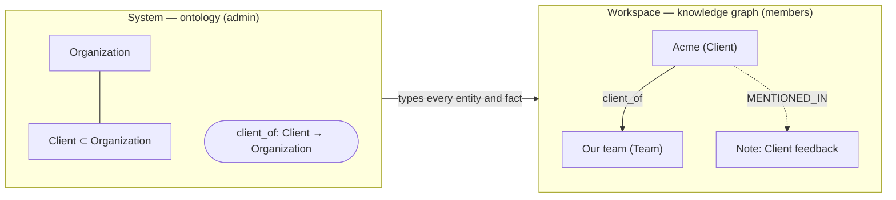

# Relations in ANA — ontology and knowledge graph

**English** · [한국어](relations.ko.md)

ANA separates **what kinds of things exist** from **what is actually known**:

| | Ontology (schema, TBox) | Knowledge graph (facts, ABox) |
|---|---|---|
| **Scope** | the **System** — one for the whole ANA, shared by every workspace | each **Workspace** — its own entities and facts |
| **Who changes it** | the **admin** (System › Ontology). New concepts proposed by an analysis arrive as approval requests in System › Inbox | **members**, by approving an analysis result (Inbox › Approvals or Knowledge › Analysis) |
| **What it holds** | classes with parents (Client ⊂ Organization), relation types with From → To | entities typed by a class, facts typed by a relation, each citing the notes/tasks/events it came from |
| **Stored in** | `ontology.json` next to `evolve.json` (+ the built-in core) | `kg.json` next to the workspace's `state.json` |
| **Seen in** | System › Ontology (edit) · Knowledge › Ontology (read-only) | Knowledge › Knowledge graph |

The ontology has a **built-in core** fixed by the app: the classes Note, Task, Event, Day and the relations SPAWNED, SCHEDULED_AS, REFERS_TO, DUE_ON, ON (`graph.js` `RULES`/`MEANINGS`). They can't be edited. Everything else (Client, works_for, …) is added by the admin.

> **The ontology is a lens, not a gate.** It is a domain harness: it gives the agent shared words and lets ANA check and reason. It never limits what the agent may find or propose. Things that don't fit are **kept and marked** *not in the ontology yet*, never dropped or held back; the admin is asked to add the concept, and once added it fits at once. Evolve proposals may go outside the ontology, and may change it.

### Seven concepts and how they connect

| Concept | What it is | Where |
|---|---|---|
| **Ontology** | the shared words: classes (with parents) and relation types (From → To, and optionally inverse / symmetric / transitive) | System — the admin curates it |
| **Knowledge graph** | the things and facts actually found, each citing the items it came from | each Workspace — members approve analyses into it |
| **System** | what applies to every workspace: features, the ontology, health | admin |
| **Workspace** | one team's data: notes, tasks, events, files, its knowledge graph | members |
| **NodeRel** | one index (`graph.sqlite`) of app links + the knowledge graph, so the agent can trace note → entity → entity | both |
| **Ontology reasoning** | deterministic rules over the knowledge graph: fit (domain → range, sub-classes), super-class types, inverse, symmetric, transitive. Computed on read, marked `inferred`, never stored | server (`kgLens`) |
| **LLM reasoning** | the agent reading items and proposing entities, facts and new concepts ([Analyze]), or changes to the system ([Evolve]). Free; the ontology only guides it | agent |

LLM reasoning **adds** knowledge (and proposes new words); ontology reasoning **checks and extends** it with what the words already imply. Neither blocks the other.



---

## How knowledge grows

```mermaid
sequenceDiagram
  participant M as Member (Knowledge › Analysis)
  participant S as ANA server
  participant A as Agent
  participant AD as Admin (System)
  M->>S: POST /api/analysis/start {kinds, focus}
  M->>A: [Analyze] instruction (curls to 127.0.0.1)
  A->>S: GET /api/analysis/input — items + the shared ontology + rules
  A->>S: POST /api/analysis/progress …
  A->>S: POST /api/analysis/result {ontology, graph}
  S->>S: check against the ontology (mark, don't drop); new concepts → admin requests
  S-->>M: "Add analysis #N to the knowledge graph?" (Inbox › Approvals)
  M->>S: POST /api/analysis/apply → kg.json (everything; Team shown "not in the ontology yet")
  AD->>S: approve "Add class Team" → POST /api/ontology
  S->>S: on the next read, Team fits — in every workspace
```

1. **Analyze.** A member picks notes / tasks / events (and an optional focus). The agent reads them with the **shared ontology** (`GET /api/analysis/input` → `ontology` + `rules`) and reports progress.
2. **Result.** `POST /api/analysis/result {summary, ontology:{classes, relations}, graph:{entities, facts}}`. The server checks it against the ontology (below) and answers with counts, `issues` and `newConcepts`.
3. **New concepts → admin, as tidying.** A class or relation the ontology doesn't have — declared in the result or just used — becomes a request in System › Inbox ("Add class "Team" to the ontology", `action: ontology.add`). It doesn't block anything: the concept is already in use.
4. **Add to the knowledge graph → member.** The result is not applied by itself. It appears in **Inbox › Approvals** and in Knowledge › Analysis. *Add* merges all of it into `kg.json`: entities by id (sources merged), facts by from·rel·to. Nothing waits.
5. **Fit is read, not stored.** `GET /api/kg` returns each entity and fact with `fit` and `why`, plus `notFitting` counts; the chart draws them in orange. When the admin adds a concept, it fits on the next read. (Facts held back by earlier versions are added when any concept is approved.)
6. *Discard* drops a result; the knowledge graph keeps everything added before. Members can remove a wrong entity or fact (`POST /api/kg {action: remove-entity|remove-fact}`).

## Checking a result against the ontology

`cleanAnalysis(body, itemIds, systemOntology())` — known concepts are the shared ontology plus the concepts proposed in the result:

| Check | If it fails |
|---|---|
| sizes (80 classes, 80 relations, 400 entities, 1200 facts) | the rest is cut |
| `class.parent`, `relation.domain/range` exist | cleared, issue |
| `entity.class` exists | kept, issue, concept sent to the admin |
| `fact.from/to` are entities | fact dropped, issue (the only thing dropped) |
| `fact.rel` exists | kept, issue, concept sent to the admin |
| `from`'s class is the domain **or a sub-class of it**, likewise `to` and range | kept, marked as not fitting, issue |
| sources are items of this job | those ids removed |

Reading the knowledge graph checks domain → range again against the **current** ontology.

## Ontology reasoning

`kgLens(kg, ontology)` runs every time the knowledge graph is read (`GET /api/kg`, NodeRel). Nothing it derives is stored.

| Rule | Set on the relation | From | Derives |
|---|---|---|---|
| sub-class | class *Kind of* | pat is a Person, Person ⊂ Agent | `types: [Person, Agent]` |
| inverse | *Inverse* (either side) | pat works_for acme, employs ⇄ works_for | acme employs pat |
| symmetric | *Symmetric* | o1 partners acme | acme partners o1 |
| transitive | *Transitive* | o1 part_of o2, o2 part_of o3 | o1 part_of o3 |

Each derived fact comes in `inferred` with `inferred: true`, `rule` and `because` (the facts it follows from). The chart draws them dashed (toggle *Inferred*), the entity panel tags them, NodeRel edges carry `inferred` and `rule`, and the Turtle export writes `owl:inverseOf`, `owl:SymmetricProperty`, `owl:TransitiveProperty` so OntoAir and other reasoners can do the same.

## The knowledge graph inside NodeRel

Each workspace's `kg.json` is indexed in the same `graph.sqlite` as the app links: entities as `kg:<id>` (kind = class), facts typed by relation id, and `MENTIONED_IN` entity → source item. So the agent can trace from a note to the people in it:

```bash
curl -s "http://127.0.0.1:8811/api/graph/trace?id=n-ex-acme&depth=2"
curl -s "http://127.0.0.1:8811/api/graph/neighbors?id=kg:acme"
curl -s "http://127.0.0.1:8811/api/graph/schema"     # built-in vocabulary + the ontology's relations
```

The Links chart and "where the flow breaks" use only the built-in relations.

## Export and OntoAir

- **Knowledge graph:** `GET /api/kg/ttl` writes OWL Turtle — the shared ontology as TBox (`owl:Class` + `rdfs:subClassOf`, `owl:ObjectProperty` + `rdfs:domain/range`) and the workspace's knowledge graph as ABox. Knowledge › Knowledge graph has *Open in OntoAir ↗* and *Download .ttl*.
- **One analysis result:** `GET /api/analysis/ttl?id=` (Knowledge › Analysis).
- OntoAir receives the Turtle inside the link (`#data:text/turtle,…`), so it works behind a sign-in gateway. Only a very large analysis falls back to a 24-hour token link (`/api/analysis/shared/<token>/<name>.ttl`), then to a download. A `#` in a label becomes `＃` because line-based parsers cut at `#`.

## Existing installs

The first time the ontology is read, the per-workspace analysis ontologies from earlier versions (`analysis.json` → `ontology` and finished jobs) are merged into `ontology.json`, skipping anything that clashes with the core. Earlier analysis results can then be added to each workspace's knowledge graph from Knowledge › Analysis.

## API summary

| Endpoint | Who | Purpose |
|---|---|---|
| `GET /api/ontology` | anyone | core + added classes and relations |
| `POST /api/ontology {action: add\|update\|remove, kind: class\|relation, item}` | admin | change the ontology (relations: `inverse`, `symmetric`, `transitive`); core is refused; a concept still used is refused |
| `POST /api/analysis/start {kinds, openOnly?, focus?}` · `GET /api/analysis/input?id=` · `POST /api/analysis/progress` · `POST /api/analysis/result` · `/fail` · `/cancel` | member · agent | run an analysis |
| `POST /api/analysis/apply {id}` · `POST /api/analysis/discard {id}` | member | add a result to the knowledge graph, or drop it |
| `GET /api/analysis` | anyone | jobs, the shared ontology, knowledge-graph size |
| `GET /api/kg` · `GET /api/kg/ttl` · `POST /api/kg {action: remove-entity\|remove-fact}` | member | the workspace's knowledge graph — with `fit`/`why`, `types`, `inferred`, `notFitting` |
| `GET /api/graph/neighbors · trace · schema` | anyone | both layers through NodeRel |

Code: `dashboard-api.js` (`CORE_ONTOLOGY`, `loadOntology`, `systemOntology`, `cleanAnalysis`, `mergeIntoKg`, `kgLens`, `applyPendingAll`, `analysisTurtle`), `graph.js` (`snapshot` with `kg`, `KG_PREFIX`), `dashboard.html` (System › Ontology `renderOntology`, Knowledge `renderKg` / `renderOntoRead`, `renderKgApprovals`, `drawKG`, `openTtlInOntoAir`). Tests: `test.cjs` C14 (app links), C16 and C18 (analysis, keep-and-mark, approvals, fit on read, reasoning, NodeRel, export), `admin.test.cjs` (migration).
