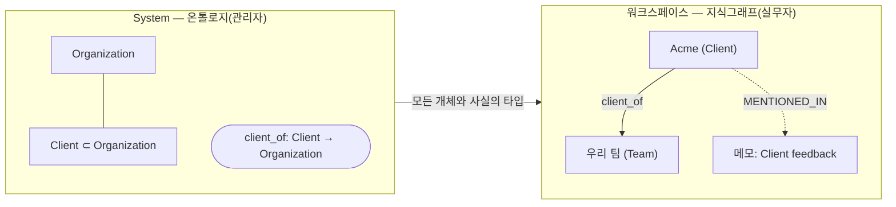
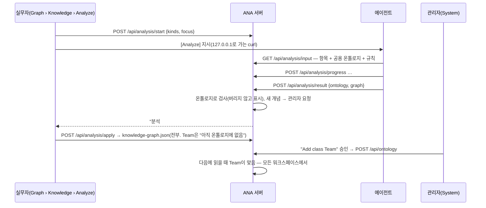

# ANA의 워크와 지식

[English](work-and-knowledge.md) · **한국어**

## 도메인 = 업무 + 지식

| | **워크(업무)** | **지식** |
|---|---|---|
| **무엇인가** | 업무 프로세스가 돌아가는 데 필요한 것. 업무가 다루는 항목과 그 흐름 | 업무를 하면서 쌓이는 것. 그 일에 얽힌 사람·대상과 그 관계 |
| **성격** | 설계된 것(처방적). 프로세스가 무엇이 있고 어디로 흘러가는지 정함 | 생겨나는 것(서술적). 일하는 동안 드러남 |
| **예** | base: 메모 → 할일 → 일정 · 저장장치: 디스크 → 볼륨 → 마운트 | 고객, 사람, 프로젝트, 이슈와 그 사이의 사실 |
| **바뀌는 때** | 프로세스가 바뀔 때(코드, Evolve) | 업무를 할 때(Analyze, 승인) |
| **필요한 성질** | 정확해야 함. 프로세스가 읽고 움직이므로 **관문** | 열려 있어야 함. 무엇이 쌓일지 미리 알 수 없으므로 **렌즈** |

규칙은 양쪽에 다 있습니다.
- **업무 규칙:** 계산하고 제약합니다. 예: 할일의 마감일 ⇒ 그날
- **지식 규칙:** 추론하고 검사합니다. 예: attends + part_of ⇒ involved_in

도메인 ANA는 **업무를 설계**하고(워크 온톨로지와 화면), **지식이 자라게** 합니다(지식 클래스 몇 개로 시작). 자란 지식은 업무를 바꿀 수 있습니다. 지식이 같은 것을 계속 보여 주면 프로세스로 승격합니다(Evolve). base ANA의 도메인은 개인·팀의 일이고, 업무는 메모 → 할일 → 일정의 흐름입니다.

## 한 장으로 보는 모델

**범위** 둘 × **층** 둘입니다. 층마다 System에 **온톨로지**(종류)가 있고, 워크스페이스마다 **그래프**(실제 것)가 있습니다.

| | **워크 층** | **지식 층** |
|---|---|---|
| **System — 온톨로지** | **워크 온톨로지**: Note, Task, Event, Day와 그 연결 종류. `work-ontology.js`(코드) | **지식 온톨로지**: Client, Person, works_for 등. `.ana/knowledge-ontology.json`(관리자) |
| **워크스페이스 — 그래프** | **워크 그래프**: 메모·할일·일정과 그 연결. `work-graph.json` | **지식그래프**: 개체와 사실. `knowledge-graph.json` |

온톨로지는 세 부분으로 되어 있고, 부분마다 그래프에 "실제 것"이 있습니다.

| 온톨로지의 부분(System) | 무엇인가 | 워크 층에서 | 지식 층에서 | 실제 것(그래프) |
|---|---|---|---|---|
| **클래스** | 점의 종류 | Note, Task, Event, Day | Client, Person, Project | 워크 항목 · 개체 |
| **관계** | 선의 종류, From → To | SPAWNED, SCHEDULED_AS, REFERS_TO, DUE_ON, ON | works_for, client_of | 연결 · 사실 |
| **규칙** | 무엇이 따라 나오는지, 무엇을 지켜야 하는지 | 계산: DUE_ON ← Task.due, ON ← Event.date | 하위 클래스, 역관계·대칭·전이, **연쇄**, **제한** | 추론된 사실, 계산된 연결, 맞음 표시. 그래프를 읽을 때 생기고 저장하지 않음 |

층마다 더 보면:

| | **워크 층** | **지식 층** |
|---|---|---|
| **한 줄 정의** | 업무 프로세스가 돌아가는 데 필요한 것 | 업무를 하면서 쌓이는 것 |
| **만드는 주체** | 사람이 앱에서 일하며 프로세스가 만듦(또는 에이전트의 데이터 변경을 승인해서) | 분석(LLM)이 제안하고 실무자가 승인 |
| **신뢰도** | 정확: 프로세스가 읽고 움직임 | 추론: 모든 개체와 사실에 근거 워크 항목이 붙음 |
| **온톨로지 바꾸는 사람** | 코드(개발자나 Evolve 제안). 기능과 같은 커밋에서 | 관리자(System › Ontology), 또는 분석이 제안한 것을 승인해서 |
| **앱에서** | **Graph › Work** · System **Ontology › Work** | **Graph › Knowledge**(그래프, *Analyze*, 최근 분석) · System **Ontology › Knowledge** |
| **API** | `source: "work"` | `source: "knowledge"` |

메뉴가 모델을 따릅니다. **System › Ontology**에는 *Work · Knowledge* 탭이 있고 탭마다 *Classes · Relations · Rules*가 있습니다. **워크스페이스 › Graph**에는 *Work · Knowledge* 탭이 있습니다. 온톨로지의 Work 탭에는 편집 버튼이 없습니다. 코드를 설명하는 것이기 때문입니다. 실무자는 Graph의 각 탭에 있는 *Ontology*로 그 층의 온톨로지를 읽기 전용으로 엽니다.

워크 온톨로지에 모든 ANA 공통인 것은 없습니다. ANA마다 `work-ontology.js`에 자기 것을 선언합니다. 할일이 없는 ANA에는 Task가 없고, 저장장치 ANA는 Disk, Volume을 선언할 수 있습니다.
- `graph-index.js`는 어휘를 이 선언에서 읽습니다.
- `admin.test.cjs`가 앱이 실제로 만드는 노드·연결 종류가 선언과 정확히 같은지 확인합니다.

## 관문이 아니라 렌즈

온톨로지는 안내하고 검사합니다. 사람이나 에이전트가 말할 수 있는 것을 막지 않습니다.

| | 워크 층 | 지식 층 |
|---|---|---|
| **구조**(필드, 클래스) | **관문**: 앱은 코드가 아는 것만 저장합니다. 화면이 그 필드를 읽기 때문입니다 | **렌즈**: 모르는 클래스도 남기고 *아직 온톨로지에 없음*으로 표시 |
| **연결·관계 종류** | **렌즈**: `BLOCKS` 같은 새 종류(대문자_밑줄)도 저장하고 *아직 워크 온톨로지에 없음*으로 보임. 아는 종류는 From → To를 지킵니다(기능이 읽음). DUE_ON / ON은 날짜에서 계산하므로 손으로 못 만듭니다 | **렌즈**: 모르는 관계, From → To가 안 맞는 사실도 남기고 표시 |
| **규칙** | 계산: 날짜에서 DUE_ON / ON | 추론: 하위 클래스, 역관계, 대칭, 전이, 연쇄 · 검사: 제한(`inferred` / `fit`, 저장 안 함) |
| **끊긴 참조** | 기능을 빼서 워크 클래스·관계가 사라지면 `issues` | 지운 것을 가리키는 클래스·관계·규칙 → `issues` |

`GET /api/ontology`가 `issues`를 돌려줍니다("Class Ticket: its parent Task is no longer in the ontology"). System › Ontology는 주황 상자로 보여 주고, 그 클래스를 *parent … missing* 표시와 함께 트리에 남깁니다.

## 두 층의 연결과 확장

| 방향 | 방법 | 코드 수정 |
|---|---|---|
| 지식 → 워크(근거) | 개체 ─`MENTIONED_IN`→ 워크 항목. 어느 메모·할일에서 나왔는지 | 없음 |
| 워크 → 지식(분석) | *Analyze*: 에이전트가 워크 항목을 읽고 개체·사실을 제안 → 실무자 승인 | 없음 |
| 지식이 워크를 넓힘 ① | **하위 클래스**: 워크 클래스의 하위 클래스로 정의된 지식 클래스(Ticket ⊂ Task, Meeting ⊂ Event)를 워크 항목에 붙입니다(`POST /api/subtype`). 앱은 그대로 할일로 다루고, 지식 쪽은 Ticket으로 읽습니다 | 없음 |
| 지식이 워크를 넓힘 ② | **승격**: `GET /api/ontology/evidence`가 근거를 보여 줍니다. 쓰이는 새 연결 종류, 항목에 붙은 하위 클래스, 개체가 주로 한 종류의 항목에서 나오는 지식 클래스("Ticket 개체 40개, 모두 할일에서") 등입니다. 시스템 Evolve가 이를 읽고 기능을 제안하고, 그 변경이 `work-ontology.js`를 고칩니다 | 있음(관리자가 시작) |
| 쓰임이 워크를 넓힘 | 새 연결 종류가 자주 쓰이면(`BLOCKS` ×12) → Evolve 제안 → 기능 | 있음 |

## 용어

| 개념 | 한국어 | English | 코드 / API |
|---|---|---|---|
| 두 범위 | System · 워크스페이스 | System · Workspace | — |
| 두 층 | 워크 층 · 지식 층 | Work layer · Knowledge layer | `source: work \| knowledge` |
| 종류 전체 | 워크 온톨로지 · 지식 온톨로지 | Work ontology · Knowledge ontology | `work-ontology.js` · `.ana/knowledge-ontology.json` |
| 실제 것 전체 | 워크 그래프 · 지식그래프 | Work graph · Knowledge graph | `work-graph.json` · `knowledge-graph.json` |
| 점의 종류 | 클래스(워크 클래스 · 지식 클래스) | class | `classes` |
| 선의 종류 | 관계(워크 관계 · 지식 관계) | relation | `relations` |
| 따라 나오는 것 / 지켜야 할 것 | 규칙 | rule | `rules` |
| 규칙의 종류 | 연쇄 · 제한 · 계산 | chain · limit · compute | `kind: chain \| limit \| compute` |
| 앱의 기록 하나 | 워크 항목 | work item (note · task · event) | Note · Task · Event · Day |
| 워크 항목 사이의 선 | 연결 | link | `work-graph.json`의 `links` |
| 지식그래프의 점 | 개체 | entity | `kg:<id>` |
| 개체 사이의 선 | 사실 | fact | `{from, rel, to}` |
| 관계가 잇는 것 | From → To | From → To | `domain` · `range`(API·OWL 안에서만) |
| 좁은 클래스 | 하위 클래스 | sub-class (*kind of*) | `parent`, 항목의 `subtype` |
| 개체가 나온 곳 | 근거 | source (*mentioned in*) | `MENTIONED_IN`, `sources` |
| 규칙으로 생김 | 추론됨 | inferred | `inferred`, `rule`, `ruleLabel`, `because` |
| 아직 안 맞음 / 규칙을 어김 | 아직 온톨로지에 없음 · 규칙 위반 | not in the ontology yet · breaks a rule | `fit: false`, `why` |
| 실무자에게 부탁하는 일 | 실행 요청 | action request | Inbox › *Action requests* |

## 무엇이 어디에 있나

| 정보 | 누가 바꾸나 | 저장 |
|---|---|---|
| 워크 온톨로지(클래스, 관계, 계산 규칙) | 코드 변경 | `work-ontology.js`(git) |
| 지식 온톨로지(클래스, 관계, 규칙) | 관리자 | `.ana/knowledge-ontology.json` |
| 워크 그래프 | 사람, 승인된 에이전트 변경 | 워크스페이스마다 `work-graph.json` |
| 지식그래프 | 실무자가 분석을 승인 | 워크스페이스마다 `knowledge-graph.json` |
| NodeRel 색인 | 자동 | 워크스페이스마다 `graph-index.sqlite`. 위 것들에서 다시 만드는 캐시 |
| 맞음 표시, 추론된 사실 | 자동(규칙) | 저장 안 함. 읽을 때 계산 |

### 일곱 개념과 그 연결

| 개념 | 무엇인가 | 어디에 |
|---|---|---|
| **온톨로지** | 클래스, 관계, 규칙. 두 층: 워크 온톨로지(코드에서)와 지식 온톨로지(관리자) | System |
| **지식그래프** | 업무에서 쌓인 개체와 사실. 각각 근거 워크 항목을 가리킴 | 워크스페이스마다 |
| **System** | 모든 워크스페이스에 걸리는 것: 기능, 온톨로지, 헬스 | 관리자 |
| **워크스페이스** | 한 팀의 워크 항목, 파일, 지식그래프 | 실무자 |
| **NodeRel** | 워크 그래프와 지식그래프를 한 색인(`graph-index.sqlite`)에. 에이전트가 메모 → 개체 → 개체로 따라감 | 둘 다 |
| **온톨로지 추론** | 온톨로지의 규칙을 읽을 때 적용. 맞는지(From → To, 하위 클래스), 상위 클래스, 역관계, 대칭, 전이, 연쇄. 제한 규칙은 어긴 것을 표시 | 서버(`kgLens`) |
| **LLM 추론** | 에이전트가 워크 항목을 읽고 개체·사실·새 종류를 제안([Analyze])하거나 시스템 변경을 제안([Evolve]). 자유롭고, 온톨로지는 안내만 함 | 에이전트 |

LLM 추론은 지식을 **더하고** 새 말을 제안합니다. 온톨로지 추론은 그것을 **검사하고**, 말이 이미 뜻하는 것으로 **넓힙니다**. 어느 쪽도 다른 쪽을 막지 않습니다.



---

## 지식이 쌓이는 과정



1. **분석.** 실무자가 메모·할일·일정과 (선택) 초점을 고릅니다. 에이전트는 **공용 온톨로지**와 함께 항목을 읽고(`GET /api/analysis/input` → `ontology` + `rules`), 진행률을 보고합니다.
2. **결과.** `POST /api/analysis/result {summary, ontology:{classes, relations}, graph:{entities, facts}}`. 서버가 온톨로지로 검사하고(아래), 개수와 `issues`, `newConcepts`를 돌려줍니다.
3. **새 개념은 관리자에게, 정리 요청으로.** 온톨로지에 없는 클래스나 관계는 System › Inbox의 요청이 됩니다("Add class "Team" to the ontology", `action: ontology.add`). 결과에 선언한 것이든 그냥 쓴 것이든 같습니다. 아무것도 막지 않습니다. 그 개념은 이미 쓰이고 있습니다.
4. **지식그래프에 더하기는 실무자가.** 결과는 저절로 들어가지 않습니다.
   - **Inbox › Approvals**와 Graph › Knowledge(*Waiting for your OK*)에 뜹니다.
   - *Add*를 누르면 `knowledge-graph.json`에 합칩니다. 개체는 id로 합치고(근거도 합침), 사실은 from·rel·to로 합칩니다.
   - 전부 들어갑니다. 기다리는 것은 없습니다.
5. **맞는지는 저장하지 않고 읽습니다.** `GET /api/kg`는 개체와 사실마다 `fit`과 `why`를, 그리고 `notFitting` 개수를 돌려줍니다. 그림에서는 주황으로 보입니다. 관리자가 개념을 더하면 다음에 읽을 때 맞음이 됩니다.
6. **버리기와 지우기.** *Discard*는 그 결과만 버리고, 이미 더한 지식은 남깁니다. 틀린 개체나 사실은 실무자가 지울 수 있습니다(`POST /api/kg {action: remove-entity|remove-fact}`).

## 결과를 온톨로지로 검사하기

`cleanAnalysis(body, itemIds, systemOntology())`. 아는 개념은 공용 온톨로지에 결과가 제안한 개념을 더한 것입니다.

| 검사 | 어기면 |
|---|---|
| 크기(클래스 80, 관계 80, 개체 400, 사실 1200) | 나머지는 잘림 |
| `class.parent`, `relation.domain/range`가 있는가 | 비우고 issue |
| `entity.class`가 있는가 | 남김, issue, 개념은 관리자에게 |
| `fact.from/to`가 개체인가 | 사실 버림, issue(버리는 것은 이것뿐) |
| `fact.rel`이 있는가 | 남김, issue, 개념은 관리자에게 |
| `from`의 클래스가 domain **또는 그 하위 클래스**인가, `to`와 range도 같은 방식 | 남김, 안 맞음 표시, issue |
| 근거가 이 작업의 항목인가 | 해당 id 제거 |

지식그래프를 읽을 때 domain → range를 **지금의** 온톨로지로 한 번 더 확인합니다.

## 규칙과 추론

규칙은 온톨로지의 세 번째 부분입니다. `kgLens(kg, ontology)`가 지식그래프를 읽을 때마다(`GET /api/kg`, NodeRel) 규칙을 적용합니다. 규칙으로 생긴 것은 저장하지 않습니다.

| 규칙 | 정하는 곳 | 종류 | 예 |
|---|---|---|---|
| 하위 클래스 | 클래스의 *Kind of* | 추론 | Person ⊂ Agent → pat은 Agent이기도 함(`types`) |
| From → To | 관계 | 검사 | works_for는 Person → Organization. 안 맞는 사실은 표시 |
| 역관계 | 관계의 *Inverse*(어느 한쪽) | 추론 | pat works_for acme ⇒ acme employs pat |
| 대칭 | 관계의 *Symmetric* | 추론 | o1 partners acme ⇒ acme partners o1 |
| 전이 | 관계의 *Transitive* | 추론 | o1 part_of o2, o2 part_of o3 ⇒ o1 part_of o3 |
| **연쇄** | System › Ontology › **Rules** | 추론 | *만약* x attends y, y part_of z *이면* x involved_in z. 1~3단계. 단계를 거꾸로 걸을 수 있음(`^attends`: 같은 워크숍 참석자 ⇒ meets). 한 단계면 하위 관계(involved_in ⇒ related_to) |
| **제한** | System › Ontology › **Rules** | 검사 | Project 하나에 *leads*는 최대 1개(To 기준). 넘는 사실은 남기고 *규칙 위반*으로 표시 |
| 계산 | `work-ontology.js`(`made: derived`) | 계산 | DUE_ON ← Task.due, ON ← Event.date. 워크 온톨로지의 규칙, 읽기 전용 |

- **엔진은 하나입니다.** 역관계·대칭·전이를 연쇄 규칙으로 바꾸고, 모든 연쇄를 고정점까지 함께 돌립니다. 다른 규칙이 추론한 사실 위에서도 규칙이 돌고, 최대 8라운드, 추론 사실 2000개까지입니다.
- **나오는 것.** 추론된 사실은 `inferred`에 `rule`(`inverse`, `transitive`, `rule:<id>` 등), `ruleLabel`, `because`(근거 사실)와 함께 옵니다.
  - 그림에서는 점선입니다(*Inferred* 토글).
  - 개체 패널에 *inferred · rule …* 표시가 붙습니다.
  - NodeRel 선에는 `inferred`와 `rule`이 붙습니다.
- **제한은 렌즈입니다.** 넘는 사실은 `fit: false`, `why: "rule one lead: at most 1 leads per To"`가 됩니다. 지우지 않습니다.
- **API.** `POST /api/ontology {action, kind: "rule", item}`(관리자)
  - 연쇄: `item: {id, label, kind: "chain", if: ["attends", "^attends"], then: "meets"}`
  - 제한: `item: {id, label, kind: "limit", rel, per: "from" | "to", max}`

  지식 관계만 쓸 수 있습니다. 규칙이 쓰는 관계는 지울 수 없고, 지워진 것을 가리키는 규칙은 `issues`에 나옵니다.
- **OWL.** Turtle 내보내기는 규칙을 표준 OWL로 씁니다. 그래서 OntoAir 같은 다른 추론기도 읽습니다.
  - 한 단계 연쇄 → `rdfs:subPropertyOf`(거꾸로면 `owl:inverseOf`)
  - 여러 단계 → `owl:propertyChainAxiom ( … )`(거꾸로 단계는 `[ owl:inverseOf … ]`)
  - 제한 → From(또는 To) 클래스에 `owl:maxCardinality`가 붙은 `owl:Restriction`
  - 그 밖에 `owl:inverseOf`, `owl:SymmetricProperty`, `owl:TransitiveProperty`

## NodeRel 안의 지식그래프

워크스페이스마다 `knowledge-graph.json`이 앱 링크와 같은 `graph-index.sqlite`에 들어갑니다.
- 개체는 `kg:<id>`이고, kind는 클래스입니다.
- 사실은 관계 id를 타입으로 갖습니다.
- 개체와 근거 항목은 `MENTIONED_IN`으로 이어집니다.

그래서 에이전트가 메모에서 그 안의 사람까지 따라갈 수 있습니다.

```bash
curl -s "http://127.0.0.1:8811/api/graph/trace?id=n-ex-acme&depth=2"
curl -s "http://127.0.0.1:8811/api/graph/neighbors?id=kg:acme"
curl -s "http://127.0.0.1:8811/api/graph/schema"     # 워크 온톨로지 + 지식 관계
```

Graph › Work(워크 그래프 그림, "흐름이 끊긴 곳", *Links by kind*)는 워크 그래프만 씁니다. 새 연결 종류는 *(new)* 표시와 함께 보입니다.

## 내보내기와 OntoAir

- **지식그래프:** `GET /api/kg/ttl`이 OWL Turtle을 씁니다.
  - 공용 온톨로지는 TBox입니다: `owl:Class` + `rdfs:subClassOf`, `owl:ObjectProperty` + `rdfs:domain/range`.
  - 워크스페이스 지식그래프는 ABox입니다.
  - Graph › Knowledge에 *Open in OntoAir ↗*와 *Download .ttl*이 있습니다.
- **분석 결과 하나:** `GET /api/analysis/ttl?id=`(Graph › Knowledge, *Latest analysis*)
- **OntoAir로 넘기는 방식:**
  - Turtle을 링크 안(`#data:text/turtle,…`)에 담아 넘기므로, 로그인 게이트웨이 뒤에서도 열립니다.
  - 아주 큰 분석만 24시간 토큰 링크(`/api/analysis/shared/<토큰>/<이름>.ttl`)로, 그것도 안 되면 내려받기로 넘어갑니다.
  - 라벨의 `#`은 `＃`로 바꿉니다. 줄 단위 파서가 `#`에서 줄을 잘라 버리기 때문입니다.

## API 요약

| 엔드포인트 | 누가 | 용도 |
|---|---|---|
| `GET /api/ontology` | 누구나 | 두 온톨로지의 `classes`, `relations`, `rules`(`source: work\|knowledge`), 그리고 `issues`(끊긴 참조) |
| `POST /api/ontology {action: add\|update\|remove, kind: class\|relation\|rule, item}` | 관리자 | 지식 온톨로지 바꾸기(관계: `inverse`, `symmetric`, `transitive`, 규칙: `chain` / `limit`). 워크 온톨로지는 거절(코드에서 옴), 아직 쓰이는 개념도 거절 |
| `POST /api/analysis/start {kinds, openOnly?, focus?}` · `GET /api/analysis/input?id=` · `POST /api/analysis/progress` · `POST /api/analysis/result` · `/fail` · `/cancel` | 실무자 · 에이전트 | 분석 실행 |
| `POST /api/analysis/apply {id}` · `POST /api/analysis/discard {id}` | 실무자 | 결과를 지식그래프에 더하기 / 버리기 |
| `GET /api/analysis` | 누구나 | 작업 목록, 공용 온톨로지, 지식그래프 크기 |
| `POST /api/subtype {id, type}` | 실무자 | 워크 항목에 하위 클래스(그 항목의 워크 클래스의 하위 클래스인 지식 클래스)를 붙임. `type: ''`이면 뗌 |
| `GET /api/ontology/evidence` | 누구나 | 승격 근거: 쓰이는 새 연결 종류, 항목에 붙은 하위 클래스, 주로 한 종류의 항목에서 나오는 지식 클래스 |
| `GET /api/kg` · `GET /api/kg/ttl` · `POST /api/kg {action: remove-entity\|remove-fact}` | 실무자 | 워크스페이스 지식그래프 — `fit`/`why`, `types`, `inferred`, `notFitting` 포함 |
| `GET /api/graph/neighbors · trace · schema` | 누구나 | NodeRel로 두 층 모두 |

코드:
- `work-ontology.js`: 워크 층
- `dashboard-api.js`: `APP_ONTOLOGY`, `loadOntology`, `systemOntology`, `ontologyIssues`, `cleanAnalysis`, `mergeIntoKg`, `kgLens`, `analysisTurtle`
- `graph-index.js`: 어휘는 `work-ontology.js`에서, `kg`를 받는 `snapshot`, `KG_PREFIX`
- `dashboard.html`: System › Ontology `renderOntology`, Knowledge `renderKg` / `renderOntoRead`, `renderKgApprovals`, `drawKG`, `openTtlInOntoAir`

테스트는 `test.cjs`의 C14(앱 링크), C16·C18(분석, 남기고 표시, 승인, 읽을 때 맞는지, 추론, NodeRel, 내보내기)과 `admin.test.cjs`(워크 층 = 앱이 실제로 만드는 것, 끊긴 참조)입니다.
