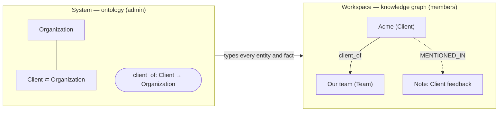

# Work and Knowledge in ANA

**English** · [한국어](work-and-knowledge.ko.md)

## A domain is work + knowledge

| | **Work** | **Knowledge** |
|---|---|---|
| **What it is** | what the work process needs to run — the items it handles and how they flow | what accumulates from doing the work — who and what it involves, and how they relate |
| **Nature** | designed (prescriptive): the process decides what exists and where it goes next | emerging (descriptive): it shows up while the work is done |
| **Examples** | base: note → task → event · storage: disk → volume → mount | clients, people, projects, issues, and the facts between them |
| **Changes when** | the process changes (code, Evolve) | the work is done (Analyze, approval) |
| **Must be** | exact — the process reads it and acts on it, so it is a **gate** | open — what will accumulate can't be known in advance, so it is a **lens** |

Rules belong to both: work rules compute and constrain (a task's due date ⇒ the day it is due); knowledge rules infer and check (attends + part_of ⇒ involved_in).

An ANA for a domain **designs the work** (its Work ontology and screens) and **lets the knowledge grow** (starting with a few Knowledge classes). What grows can reshape the work: when knowledge keeps showing the same thing, it can be promoted into the process (Evolve). Base ANA's domain is a person's or a team's own work: notes → tasks → events.

## The model in one table

Two **scopes** × two **layers**. Each layer has an **ontology** (the kinds) in the System and a **graph** (the actual things) in each workspace.

| | **Work layer** | **Knowledge layer** |
|---|---|---|
| **System — ontology** | **Work ontology**: Note, Task, Event, Day and their link kinds. `work-ontology.js` (code) | **Knowledge ontology**: Client, Person, works_for… `.ana/knowledge-ontology.json` (admin) |
| **Workspace — graph** | **Work graph**: notes, tasks, events and their links. `work-graph.json` | **Knowledge graph**: entities and facts. `knowledge-graph.json` |

An ontology has three parts, and each has its "actual thing" in the graph:

| Ontology part (System) | What it is | In the Work layer | In the Knowledge layer | Actual thing (graph) |
|---|---|---|---|---|
| **Class** | a kind of point | Note, Task, Event, Day | Client, Person, Project | work item · entity |
| **Relation** | a kind of line, From → To | SPAWNED, SCHEDULED_AS, REFERS_TO, DUE_ON, ON | works_for, client_of | link · fact |
| **Rule** | what follows, or what must hold | compute: DUE_ON ← Task.due, ON ← Event.date | sub-class; inverse / symmetric / transitive; **chain**; **limit** | inferred facts, computed links, *fit* marks — made when the graph is read, never stored |

More about each layer:

| | **Work layer** | **Knowledge layer** |
|---|---|---|
| **In one line** | what the work process needs to run | what accumulates from doing the work |
| **Made by** | the process, as people do the work in the app (or the agent's data changes once approved) | an analysis (LLM) proposes it, a member approves it |
| **How sure** | exact — the process reads it and acts on it | inferred — every entity and fact cites the work items it came from |
| **Ontology changed by** | the code (a developer or an Evolve proposal), in the same commit as the feature | the admin (System › Ontology), or by approving what an analysis proposed |
| **In the app** | **Graph › Work** · System **Ontology › Work** | **Graph › Knowledge** (graph, *Analyze*, latest analysis) · System **Ontology › Knowledge** |
| **API** | `source: "work"` | `source: "knowledge"` |

The menus follow the model: **System › Ontology** has the tabs *Work · Knowledge*, each with *Classes · Relations · Rules*; **Workspace › Graph** has the tabs *Work · Knowledge*. The Work tab of the ontology has no edit buttons — it describes the code. Members open either ontology read-only with *Ontology* on the matching Graph tab.

Nothing in the Work ontology is universal. Each ANA declares its own in `work-ontology.js`: an ANA without tasks has no Task, a storage ANA may declare Disk and Volume. `graph-index.js` reads its vocabulary from it, and `admin.test.cjs` checks that the node kinds and link kinds the app really produces are exactly the declared ones.

## A lens, not a gate

The ontology guides and checks; it never limits what people or the agent may say.

| | Work layer | Knowledge layer |
|---|---|---|
| **Structure** (fields, classes) | **gate** — the app stores only what its code understands, because its screens read those fields | **lens** — an unknown class is kept and marked *not in the ontology yet* |
| **Link / relation kinds** | **lens** — a new kind like `BLOCKS` (UPPER_SNAKE_CASE) is stored and shown as *not in the Work ontology yet*; the known kinds keep their From → To (features read them), and DUE_ON / ON can't be made by hand (they come from dates) | **lens** — an unknown relation, or a fact whose From → To doesn't match, is kept and marked |
| **Rules** | compute: DUE_ON / ON from dates | infer: sub-class, inverse, symmetric, transitive, chain · check: limit (`inferred` / `fit`, never stored) |
| **Broken references** | a Work class or relation removed with its feature → `issues` | a class, relation or rule that points at something removed → `issues` |

`GET /api/ontology` returns `issues` ("Class Ticket: its parent Task is no longer in the ontology"); System › Ontology shows them in an orange box and keeps the class in the tree, tagged *parent … missing*.

## How the layers connect and grow

| Direction | How | Code change |
|---|---|---|
| Knowledge → Work (source) | entity ─`MENTIONED_IN`→ work item: which note or task it came from | no |
| Work → Knowledge (analysis) | *Analyze*: the agent reads work items and proposes entities and facts → a member approves | no |
| Knowledge widens Work ① | **sub-classes**: a Knowledge class defined as a kind of a Work class (Ticket ⊂ Task, Meeting ⊂ Event) can be put on a work item (`POST /api/subtype`). The app still treats it as a task; the knowledge side reads it as a Ticket | no |
| Knowledge widens Work ② | **promotion**: `GET /api/ontology/evidence` shows new link kinds in use, sub-classes put on items, and Knowledge classes whose entities mostly come from one kind of item ("40 Ticket entities, all from tasks"). The system Evolve reads it and proposes a feature; the change updates `work-ontology.js` | yes — the admin starts it |
| Use widens Work | a new link kind used often (`BLOCKS` ×12) → an Evolve proposal → a feature | yes |

## Glossary

| Concept | 한국어 | English | Code / API |
|---|---|---|---|
| the two scopes | System · 워크스페이스 | System · Workspace | — |
| the two layers | 워크 층 · 지식 층 | Work layer · Knowledge layer | `source: work \| knowledge` |
| the kinds, as a whole | 워크 온톨로지 · 지식 온톨로지 | Work ontology · Knowledge ontology | `work-ontology.js` · `.ana/knowledge-ontology.json` |
| the actual things, as a whole | 워크 그래프 · 지식그래프 | Work graph · Knowledge graph | `work-graph.json` · `knowledge-graph.json` |
| a kind of point | 클래스 (워크 클래스 · 지식 클래스) | class | `classes` |
| a kind of line | 관계 (워크 관계 · 지식 관계) | relation | `relations` |
| what follows / must hold | 규칙 | rule | `rules` |
| a rule kind | 연쇄 · 제한 · 계산 | chain · limit · compute | `kind: chain \| limit \| compute` |
| one record in the app | 워크 항목 | work item (note · task · event) | Note · Task · Event · Day |
| a line between work items | 연결 | link | `work-graph.json` `links` |
| a point in the knowledge graph | 개체 | entity | `kg:<id>` |
| a line between entities | 사실 | fact | `{from, rel, to}` |
| what a relation joins | From → To | From → To | `domain` · `range` (API and OWL only) |
| a narrower class | 하위 클래스 | sub-class (*kind of*) | `parent`, item `subtype` |
| where an entity came from | 근거 | source (*mentioned in*) | `MENTIONED_IN`, `sources` |
| made by a rule | 추론됨 | inferred | `inferred`, `rule`, `ruleLabel`, `because` |
| doesn't fit yet / breaks a rule | 아직 온톨로지에 없음 · 규칙 위반 | not in the ontology yet · breaks a rule | `fit: false`, `why` |
| what a member is asked to do | 실행 요청 | action request | Inbox › *Action requests* |

## Where everything lives

| Information | Changed by | Stored in |
|---|---|---|
| Work ontology (classes, relations, compute rules) | code changes | `work-ontology.js` (git) |
| Knowledge ontology (classes, relations, rules) | admin | `.ana/knowledge-ontology.json` |
| Work graph | people, approved agent changes | `work-graph.json` per workspace |
| Knowledge graph | members approving analyses | `knowledge-graph.json` per workspace |
| NodeRel index | automatic | `graph-index.sqlite` per workspace — a cache rebuilt from the above |
| Fit marks, inferred facts | automatic (rules) | not stored — computed on read |

### Seven concepts and how they connect

| Concept | What it is | Where |
|---|---|---|
| **Ontology** | classes, relations and rules, in two layers — the Work ontology (from the code) and the Knowledge ontology (the admin's) | System |
| **Knowledge graph** | the entities and facts that accumulate from the work, each citing the work items it came from | each Workspace |
| **System** | what applies to every workspace: features, the ontology, health | admin |
| **Workspace** | one team's work items, files, and knowledge graph | members |
| **NodeRel** | one index (`graph-index.sqlite`) of the work graph + the knowledge graph, so the agent can trace note → entity → entity | both |
| **Ontology reasoning** | the ontology's rules applied on read: fit (From → To, sub-classes), sub-class types, inverse, symmetric, transitive, chain rules; limit rules mark what breaks them | server (`kgLens`) |
| **LLM reasoning** | the agent reading work items and proposing entities, facts and new kinds ([Analyze]), or system changes ([Evolve]). Free; the ontology only guides it | agent |

LLM reasoning **adds** knowledge (and proposes new words); ontology reasoning **checks and extends** it with what the words already imply. Neither blocks the other.



---

## How knowledge grows

```mermaid
sequenceDiagram
  participant M as Member (Graph › Knowledge › Analyze)
  participant S as ANA server
  participant A as Agent
  participant AD as Admin (System)
  M->>S: POST /api/analysis/start {kinds, focus}
  M->>A: [Analyze] instruction (curls to 127.0.0.1)
  A->>S: GET /api/analysis/input — items + the shared ontology + rules
  A->>S: POST /api/analysis/progress …
  A->>S: POST /api/analysis/result {ontology, graph}
  S->>S: check against the ontology (mark, don't drop); new concepts → admin requests
  S-->>M: "Add analysis #N to the knowledge graph?" (Inbox › Approvals)
  M->>S: POST /api/analysis/apply → knowledge-graph.json (everything; Team shown "not in the ontology yet")
  AD->>S: approve "Add class Team" → POST /api/ontology
  S->>S: on the next read, Team fits — in every workspace
```

1. **Analyze.** A member picks notes / tasks / events (and an optional focus). The agent reads them with the **shared ontology** (`GET /api/analysis/input` → `ontology` + `rules`) and reports progress.
2. **Result.** `POST /api/analysis/result {summary, ontology:{classes, relations}, graph:{entities, facts}}`. The server checks it against the ontology (below) and answers with counts, `issues` and `newConcepts`.
3. **New concepts → admin, as tidying.** A class or relation the ontology doesn't have — declared in the result or just used — becomes a request in System › Inbox ("Add class "Team" to the ontology", `action: ontology.add`). It doesn't block anything: the concept is already in use.
4. **Add to the knowledge graph → member.** The result is not applied by itself. It appears in **Inbox › Approvals** and on Graph › Knowledge (*Waiting for your OK*). *Add* merges all of it into `knowledge-graph.json`: entities by id (sources merged), facts by from·rel·to. Nothing waits.
5. **Fit is read, not stored.** `GET /api/kg` returns each entity and fact with `fit` and `why`, plus `notFitting` counts; the chart draws them in orange. When the admin adds a concept, it fits on the next read. 
6. *Discard* drops a result; the knowledge graph keeps everything added before. Members can remove a wrong entity or fact (`POST /api/kg {action: remove-entity|remove-fact}`).

## Checking a result against the ontology

`cleanAnalysis(body, itemIds, systemOntology())` — known concepts are the shared ontology plus the concepts proposed in the result:

| Check | If it fails |
|---|---|
| sizes (80 classes, 80 relations, 400 entities, 1200 facts) | the rest is cut |
| `class.parent`, `relation.domain/range` exist | cleared, issue |
| `entity.class` exists | kept, issue, concept sent to the admin |
| `fact.from/to` are entities | fact dropped, issue (the only thing dropped) |
| `fact.rel` exists | kept, issue, concept sent to the admin |
| `from`'s class is the domain **or a sub-class of it**, likewise `to` and range | kept, marked as not fitting, issue |
| sources are items of this job | those ids removed |

Reading the knowledge graph checks domain → range again against the **current** ontology.

## Rules and reasoning

Rules are the third part of an ontology. `kgLens(kg, ontology)` applies them every time the knowledge graph is read (`GET /api/kg`, NodeRel). Nothing they derive is stored.

| Rule | Where it is set | Kind | Example |
|---|---|---|---|
| sub-class | a class's *Kind of* | infer | Person ⊂ Agent → pat is also an Agent (`types`) |
| From → To | a relation | check | works_for goes Person → Organization; a fact that doesn't is marked |
| inverse | a relation's *Inverse* (either side) | infer | pat works_for acme ⇒ acme employs pat |
| symmetric | a relation's *Symmetric* | infer | o1 partners acme ⇒ acme partners o1 |
| transitive | a relation's *Transitive* | infer | o1 part_of o2, o2 part_of o3 ⇒ o1 part_of o3 |
| **chain** | System › Ontology › **Rules** | infer | *if* x attends y, y part_of z *then* x involved_in z. 1 to 3 steps; a step can be walked in reverse (`^attends`: people at the same workshop ⇒ meets). One step = a sub-relation (involved_in ⇒ related_to) |
| **limit** | System › Ontology › **Rules** | check | at most 1 *leads* per Project (per To). The extra facts are kept and marked *breaks a rule* |
| compute | `work-ontology.js` (`made: derived`) | compute | DUE_ON ← Task.due, ON ← Event.date — the Work ontology's rules, read-only |

- **One engine.** Inverse, symmetric and transitive are turned into chain rules, and all chains run together to a fixed point (rules build on facts other rules inferred; at most 8 rounds and 2000 inferred facts).
- **What comes out.** Each derived fact is in `inferred` with `rule` (`inverse`, `transitive`, `rule:<id>` …), `ruleLabel` and `because` (the facts it follows from). The chart draws it dashed (toggle *Inferred*), the entity panel tags it *inferred · rule …*, and NodeRel edges carry `inferred` and `rule`.
- **Limits are a lens.** A fact over the limit gets `fit: false` and `why: "rule one lead: at most 1 leads per To"`. Nothing is deleted.
- **API.** `POST /api/ontology {action, kind: "rule", item}` (admin):
  - chain: `item: {id, label, kind: "chain", if: ["attends", "^attends"], then: "meets"}`
  - limit: `item: {id, label, kind: "limit", rel, per: "from" | "to", max}`

  Only Knowledge relations can be used. A relation a rule uses can't be removed, and rules that point at something removed show up in `issues`.
- **OWL.** The Turtle export writes rules as standard OWL, so OntoAir and other reasoners read them too: one-step chain → `rdfs:subPropertyOf` (or `owl:inverseOf` if reversed), longer chain → `owl:propertyChainAxiom ( … )` (reverse steps as `[ owl:inverseOf … ]`), limit → an `owl:Restriction` with `owl:maxCardinality` on the From (or To) class, plus `owl:inverseOf`, `owl:SymmetricProperty`, `owl:TransitiveProperty`.

## The knowledge graph inside NodeRel

Each workspace's `knowledge-graph.json` is indexed in the same `graph-index.sqlite` as the app links: entities as `kg:<id>` (kind = class), facts typed by relation id, and `MENTIONED_IN` entity → source item. So the agent can trace from a note to the people in it:

```bash
curl -s "http://127.0.0.1:8811/api/graph/trace?id=n-ex-acme&depth=2"
curl -s "http://127.0.0.1:8811/api/graph/neighbors?id=kg:acme"
curl -s "http://127.0.0.1:8811/api/graph/schema"     # Work ontology + Knowledge relations
```

Graph › Work (the work-graph chart, "where the flow breaks", *Links by kind*) uses only the work graph; new link kinds show there marked *(new)*.

## Export and OntoAir

- **Knowledge graph:** `GET /api/kg/ttl` writes OWL Turtle — the shared ontology as TBox (`owl:Class` + `rdfs:subClassOf`, `owl:ObjectProperty` + `rdfs:domain/range`) and the workspace's knowledge graph as ABox. Graph › Knowledge has *Open in OntoAir ↗* and *Download .ttl*.
- **One analysis result:** `GET /api/analysis/ttl?id=` (Graph › Knowledge, *Latest analysis*).
- OntoAir receives the Turtle inside the link (`#data:text/turtle,…`), so it works behind a sign-in gateway. Only a very large analysis falls back to a 24-hour token link (`/api/analysis/shared/<token>/<name>.ttl`), then to a download. A `#` in a label becomes `＃` because line-based parsers cut at `#`.

## API summary

| Endpoint | Who | Purpose |
|---|---|---|
| `GET /api/ontology` | anyone | both ontologies — `classes`, `relations`, `rules` with `source: work\|knowledge` — plus `issues` (broken references) |
| `POST /api/ontology {action: add\|update\|remove, kind: class\|relation\|rule, item}` | admin | change the Knowledge ontology (relations: `inverse`, `symmetric`, `transitive`; rules: `chain` / `limit`); the Work ontology is refused (it comes from the code); a concept still used is refused |
| `POST /api/analysis/start {kinds, openOnly?, focus?}` · `GET /api/analysis/input?id=` · `POST /api/analysis/progress` · `POST /api/analysis/result` · `/fail` · `/cancel` | member · agent | run an analysis |
| `POST /api/analysis/apply {id}` · `POST /api/analysis/discard {id}` | member | add a result to the knowledge graph, or drop it |
| `GET /api/analysis` | anyone | jobs, the shared ontology, knowledge-graph size |
| `POST /api/subtype {id, type}` | member | put a sub-class (a Knowledge class that is a kind of the item's Work class) on a work item; `type: ''` removes it |
| `GET /api/ontology/evidence` | anyone | promotion evidence: new link kinds in use, sub-classes on items, Knowledge classes mostly found in one kind of item |
| `GET /api/kg` · `GET /api/kg/ttl` · `POST /api/kg {action: remove-entity\|remove-fact}` | member | the workspace's knowledge graph — with `fit`/`why`, `types`, `inferred`, `notFitting` |
| `GET /api/graph/neighbors · trace · schema` | anyone | both layers through NodeRel |

Code: `work-ontology.js` (the Work layer), `dashboard-api.js` (`APP_ONTOLOGY`, `loadOntology`, `systemOntology`, `ontologyIssues`, `cleanAnalysis`, `mergeIntoKg`, `kgLens`, `analysisTurtle`), `graph-index.js` (vocabulary from `work-ontology.js`, `snapshot` with `kg`, `KG_PREFIX`), `dashboard.html` (System › Ontology `renderOntology`, Knowledge `renderKg` / `renderOntoRead`, `renderKgApprovals`, `drawKG`, `openTtlInOntoAir`). Tests: `test.cjs` C14 (app links), C16 and C18 (analysis, keep-and-mark, approvals, fit on read, reasoning, NodeRel, export), `admin.test.cjs` (Work layer = what the app produces, broken references).
